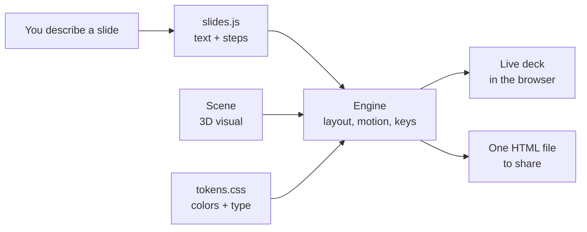

# Docs

Start here. Pick the page that matches what you want to do.

| I want to…                                   | Read                                         |
|----------------------------------------------|----------------------------------------------|
| Set it up and see a deck running             | [Getting started](./getting-started.md)      |
| Understand how the pieces fit together       | [How it works](./how-it-works.md)            |
| Write slides: text, layouts, steps           | [Writing slides](./writing-slides.md)        |
| Pick or make the 3D background visuals       | [Scenes](./scenes.md)                        |
| Change colors, fonts, spacing, motion        | [Customizing the look](./customizing.md)     |
| Add click-to-expand side panels              | [Detail sheets](./detail-sheets.md)          |
| Present it, export it, check it              | [Presenting & exporting](./presenting.md)    |
| Have an AI assistant build the deck for me   | [Working with an AI assistant](./working-with-ai.md) |

## The whole thing in one picture

## Words used in these docs

| Word        | Means                                                               |
|-------------|---------------------------------------------------------------------|
| **Deck**    | One presentation. Lives in its own folder in `decks/`.             |
| **Engine**  | The shared machinery in `src/`. Every deck uses it.                |
| **Slide**   | One screen of the deck.                                             |
| **Step**    | One press of the arrow key inside a slide. Things appear per step. |
| **Block**   | One piece of content: a title, a paragraph, a list, a stat…        |
| **Scene**   | The animated 3D visual behind the slide.                           |
| **Token**   | A named color or size (like `--signal`) used instead of a raw value. |
| **Signal**  | The amber accent. Means "this is the thing that matters right now." |
