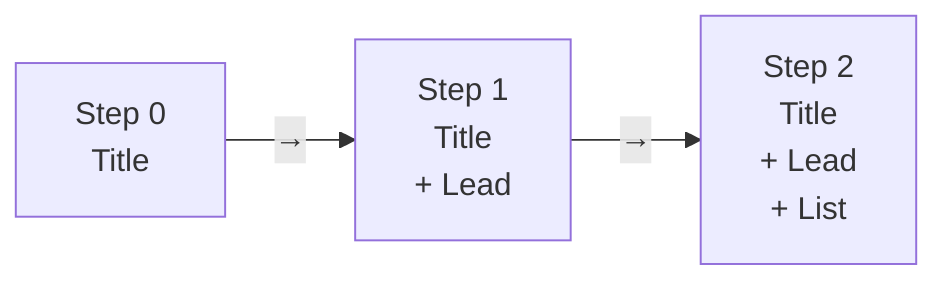

# How it works

## Engine and decks

Think of it like a Figma library and the files that use it. The **engine** is
the library: navigation, motion, themes, 3D. Each **deck** is a file that only
holds its own content.

```
webgl-deck-engine/
├── src/            THE ENGINE — shared by every deck
├── decks/
│   ├── example/    a deck
│   └── my-talk/    another deck
├── templates/deck/ the blank deck that `npm run new` copies
└── scripts/        build, new deck, checking tools
```

| Change something in… | It affects…                    |
|----------------------|--------------------------------|
| `decks/my-talk/`     | only that deck                 |
| `src/`               | **every** deck                 |
| `dist/*.html`        | nothing — exports are frozen snapshots |

## Two layers on every slide

```
┌──────────────────────────────────────────────┐
│  HTML layer — your words                     │  ← blocks from slides.js
│  ┌──────────────┐                            │
│  │ Title        │        · · ·  ·            │
│  │ Lead line    │      ·  ─── ·  ·           │  ← WebGL layer — the scene
│  │ • point      │       · ·  ·───·           │
│  └──────────────┘                            │
└──────────────────────────────────────────────┘
```

The engine measures where your text ends and moves the 3D camera so the scene
fills the space that's left. You never position the scene by hand.

## Slides are built from steps

Each arrow press is a **step**. Every block says which step it shows up on.
Once something appears, it stays — nothing jumps around.



The scene listens to the same steps, so the visual changes in time with the
words (for example: step 1 lights up a branch, step 2 picks one leaf).

## Color has a meaning

| Color         | Token         | Use it for                              |
|---------------|---------------|-----------------------------------------|
| Text greys    | `--text` `--dim` `--faint` | copy, from most to least important |
| Slate blue    | `--structure` | structure: labels, edges, keys          |
| Amber         | `--signal`    | **the one thing that matters right now** |

Only two accent colors. Use amber once per step, not five times.

## Safety nets

| If…                                    | The deck…                               |
|----------------------------------------|-----------------------------------------|
| The computer can't do 3D               | still works, with a flat background     |
| The viewer prefers reduced motion      | shows everything instantly, no animation |
| There's no internet                    | works — the export has everything inside |

Next: [Writing slides](./writing-slides.md)
