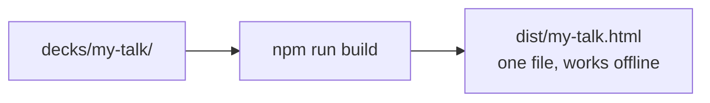

# Presenting & exporting

## Export a deck

```bash
npm run build -- my-talk      # one deck  → dist/my-talk.html
npm run build -- --all        # every deck
```

You get **one HTML file** with everything inside: text, fonts, images, 3D.
No internet needed. Email it, put it on a USB stick, double-click to open.



An exported file is a snapshot. Later changes to the engine never touch it.
Export again to pick them up.

## Before you present

| Check                                  | How                                  |
|----------------------------------------|--------------------------------------|
| Everything works (keys, panels, themes) | `npm run verify -- --deck my-talk`  |
| How every slide looks, dark            | `npm run shots -- --deck my-talk --all` |
| …and light                             | add `--theme light`                  |
| On a projector-sized screen            | add `--size 1280x720`               |
| Just one slide                         | `npm run shots -- --deck my-talk 4.2` (slide 4, step 2) |

Screenshots land in `shots/my-talk/`. These tools use Google Chrome.

## Presenting tips

- Press `F` for fullscreen, `O` to jump anywhere.
- Add `?theme=light` to the address to force a theme (bright rooms love it).
- Link to an exact moment: `my-talk.html#6.1` opens slide 6, step 1.
- If the venue's computer can't do 3D, the deck still works with a flat background.

Next: [Working with an AI assistant](./working-with-ai.md)
