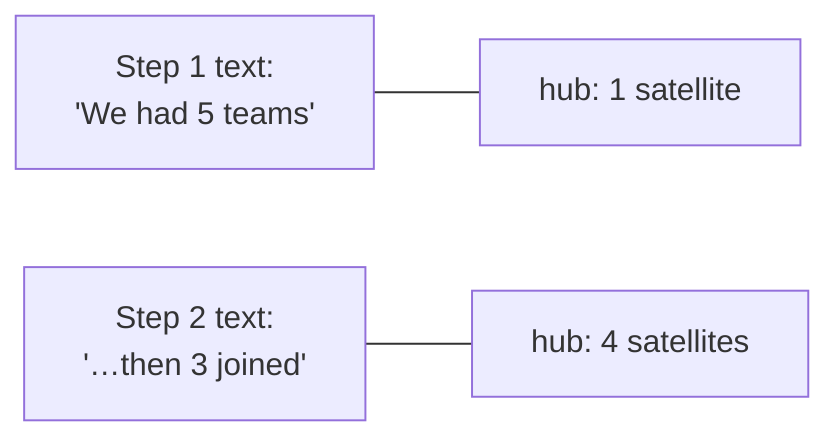
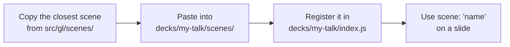

# Scenes

A scene is the animated 3D visual behind a slide: dots and lines that light up
step by step. Pick one with `scene: 'name'` on a slide, or `scene: null` for none.

## The library

| Scene      | Looks like                         | What changes per step                        | Good for |
|------------|------------------------------------|----------------------------------------------|----------|
| `drift`    | a loose cloud of dots              | 1: a few dots light up                       | covers, calm openers |
| `path`     | a cloud with a curve through it    | 1: path + moving pulse · 2: nearby dots light · 3: one joins | journeys, process |
| `tree`     | a 3-level hierarchy                | 1: tree lights · 2: one branch · 3: one leaf  | narrowing down, choices |
| `hub`      | a center with 5 satellites         | each step: one more satellite connects        | one thing serving many |
| `clusters` | three groups                       | 1: first group · 2: all three · 3: links between them | teams, categories |
| `lattice`  | a curved wall with three channels  | 1: wall · 2–4: channels 1, 2, 3 light         | layers, pipelines |
| `wave`     | a tilted sheet with a moving swell | 1: sheet lights · 2: one band in amber        | closings, momentum |
| `aurora`   | soft flowing color                 | faint → full → leaning amber                  | atmosphere, quotes |

Open `decks/example` to see each one.

## Match the scene to the story

A scene should **say the same thing as the text**, not decorate it.

If the slide has 3 steps and the scene only reacts to 2, the last step keeps
the scene as it was. That's fine.

## Making your own scene

A scene file has four parts:

| Part      | Job                                              |
|-----------|--------------------------------------------------|
| `build()` | places the dots and lines (same layout every time) |
| `step()`  | decides what lights up on each step              |
| `tick()`  | small continuous movement (optional)             |
| `camera`  | how far back the camera sits                     |

Dots and lines use the same color meanings as the text (`dim`, `structure`,
`signal`…), so scenes switch with the theme on their own.

**Only this deck needs it?** Keep it in the deck's `scenes/` folder.
**A second deck wants it too?** Move it to `src/gl/scenes/` and add it to
`src/gl/scenes/index.js` so every deck can use it.

The technical details (exact fields, helpers) are in [`CLAUDE.md`](../CLAUDE.md#scenes).

Next: [Customizing the look](./customizing.md)
