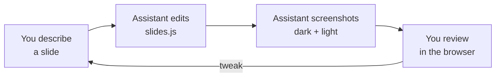

# Working with an AI assistant

This repo is built so an AI coding assistant (Claude Code, Cursor, Codex…)
can write the deck while you describe it. The assistant reads
[`AGENTS.md`](../AGENTS.md) and [`CLAUDE.md`](../CLAUDE.md) for the rules.

## How to describe a slide

Say **which deck**, then for each slide:

| Tell it                 | Example                                    |
|-------------------------|--------------------------------------------|
| What it says            | title "Three teams, one library"           |
| Where the text sits     | layout left                                |
| What the visual shows   | use `hub`, or "something that shows growth" |
| What each arrow press adds | step 1: stats. step 2: one line, "doubled" in amber |

### Example

> **my-talk, slide 3:** title "Three teams, one library". Layout left. Use the
> `hub` scene. Step 1: a stat row — 3 teams, 140 components, 12 releases.
> Step 2: a body line saying adoption doubled, with "doubled" in signal.

## Good to know

- You don't need the exact field names. "Big quote, centered" is enough.
- Don't know which scene? Describe the idea ("narrowing down to one choice")
  and let it pick — or ask for a new scene.
- Ask it to **check both themes** if it doesn't on its own.
- Name the deck every time if you have more than one.

Back to the [docs index](./README.md).
